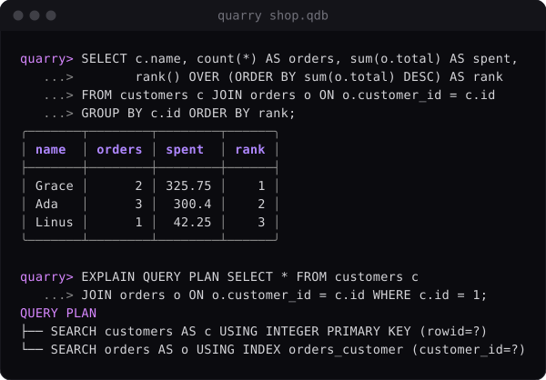
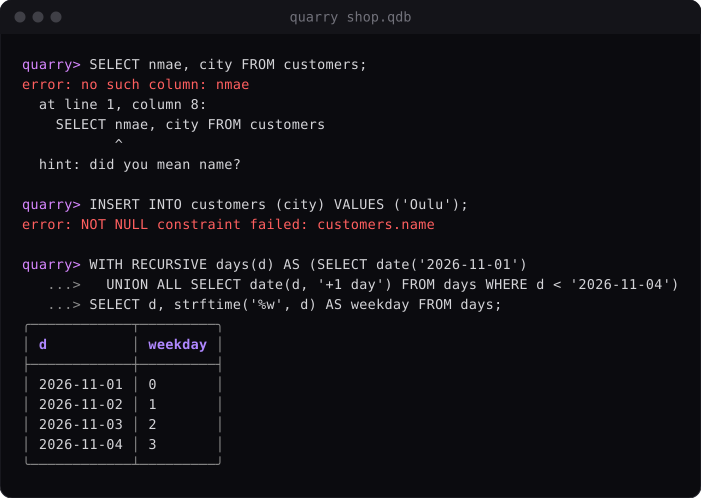

<div align="center">

# QUARRY

**A relational database engine written from scratch in pure Python.**

B+tree storage · write-ahead log · cost-aware query planner · SQLite-compatible SQL · zero dependencies

[](https://github.com/jullewz/quarry/actions/workflows/ci.yml)


[](LICENSE)



</div>

Quarry stores your tables in a single file, keeps every commit safe with a write-ahead log, and answers SQL the
way SQLite does: same types, same NULL rules, same affinity conversions, same functions. Every layer is plain
Python you can read: the page format, the B+tree, the crash recovery, the parser, the planner and the executor.

It is a complete database you can use from Python (with the standard DB-API), from an interactive shell, or as
a way to learn how databases work on the inside.

```python
import quarry

db = quarry.connect("shop.qdb")
db.execute("CREATE TABLE products (id INTEGER PRIMARY KEY, name TEXT NOT NULL, price REAL CHECK (price >= 0))")
db.executemany("INSERT INTO products (name, price) VALUES (?, ?)", [("tea", 4.5), ("coffee", 7.25)])
db.commit()

db.execute("SELECT name FROM products WHERE price > ?", (5,)).fetchall()   # [('coffee',)]
```

## Highlights

- **Real storage engine.** Tables and indexes are B+trees in 4 KiB pages. Large values spill into overflow
  pages. Freed pages go on a free list and get reused. `VACUUM` rebuilds the file compactly.
- **Crash safe.** Commits go to a write-ahead log with chained CRC-32 checksums and a commit marker. After a crash,
  every committed transaction is there, whole, and no partial one is. A test kills a writing process at random
  moments and checks this every time.
- **Transactions with savepoints.** `BEGIN`, `COMMIT`, `ROLLBACK`, nested `SAVEPOINT`s, and statement-level
  atomicity: a failed `INSERT` of ten rows changes nothing.
- **A query planner.** It pushes each `WHERE` condition down to the earliest join level, picks rowid lookups,
  index equality and range scans, or builds a hash join when no index helps. `EXPLAIN QUERY PLAN` shows the
  choice.
- **A large slice of SQLite's SQL.** Joins, subqueries (correlated too), `WITH` and `WITH RECURSIVE`, window
  functions, `UNION`/`INTERSECT`/`EXCEPT`, upserts, `RETURNING`, views, `ALTER TABLE`, `CHECK`/`UNIQUE`/`NOT NULL`,
  collations, 66 scalar functions and full date/time support.
- **Checked against SQLite.** The test suite runs hundreds of queries on both Quarry and SQLite and requires
  identical answers. A fuzzer generates thousands more.
- **Errors that help.** Messages point at the exact spot in your SQL and suggest a fix.



## Install

Quarry needs Python 3.11 or newer and nothing else. It runs on Windows 10 and 11, macOS and Linux.

```bash
git clone https://github.com/jullewz/quarry.git
cd quarry
pip install .
```

On Windows, run the same commands in PowerShell or Command Prompt. You can also use Quarry without installing:
add `src` to `PYTHONPATH`, or run `python -m quarry` from the `src` folder.

## The shell

```bash
quarry shop.qdb                       # open (or create) a database
quarry shop.qdb "SELECT * FROM t"     # run SQL and exit
quarry shop.qdb -m csv "SELECT ..."   # csv, tsv, json, markdown, line, list, table or box output
quarry < examples/analytics.sql       # run a script
```

Type SQL ending in `;`. Statements can span lines. The shell keeps a history and supports these commands:

| Command | What it does |
| --- | --- |
| `.tables`, `.schema [name]`, `.indexes` | look at the schema |
| `.mode box\|table\|markdown\|csv\|tsv\|json\|line\|list` | change the output format |
| `.plan SELECT ...` | draw the query plan as a tree |
| `.import file.csv table` | load a CSV file, creating the table with guessed column types |
| `.export file.csv SELECT ...` | save a query result as CSV |
| `.dump [file]` | SQL that recreates the whole database |
| `.check`, `.stats` | integrity check, page and log statistics |
| `.timer on`, `.headers on`, `.nullvalue X`, `.read file`, `.open file` | the usual helpers |

## Python API

Quarry follows PEP 249 and behaves like the standard `sqlite3` module, so most code works by changing the import.

```python
import quarry

with quarry.connect("library.qdb") as db:          # commits on success, rolls back on error
    db.execute("CREATE TABLE IF NOT EXISTS books (id INTEGER PRIMARY KEY, title TEXT UNIQUE, year INT)")
    db.execute(
        "INSERT INTO books (title, year) VALUES (:title, :year) "
        "ON CONFLICT (title) DO UPDATE SET year = excluded.year",
        {"title": "Solaris", "year": 1961},
    )

db = quarry.connect("library.qdb")
db.row_factory = quarry.Row                        # rows that also work like dicts
for book in db.execute("SELECT * FROM books ORDER BY year"):
    print(book["title"], book["year"])
```

Supported: `connect`, `cursor`, `execute`, `executemany`, `executescript`, `fetchone`, `fetchmany`, `fetchall`,
`description`, `rowcount`, `lastrowid`, `commit`, `rollback`, `iterdump`, `backup`, `row_factory`, `?`, `?NNN`,
`:name`, `@name` and `$name` parameters, and the full PEP 249 exception hierarchy. Pass `autocommit=True` to
commit each statement on its own.

## What SQL works

| Area | Supported |
| --- | --- |
| Queries | `SELECT`, `DISTINCT`, `WHERE`, `GROUP BY`, `HAVING`, `ORDER BY ... NULLS FIRST/LAST`, `LIMIT`/`OFFSET`, `VALUES` |
| Joins | inner, `LEFT`, `CROSS`, comma joins, `USING`, `NATURAL` |
| Subqueries | scalar, `IN`, `EXISTS`, in `FROM`, correlated |
| Common table expressions | `WITH`, `WITH RECURSIVE` (`UNION` and `UNION ALL`) |
| Compound queries | `UNION`, `UNION ALL`, `INTERSECT`, `EXCEPT` |
| Window functions | `row_number`, `rank`, `dense_rank`, `percent_rank`, `cume_dist`, `ntile`, `lag`, `lead`, `first_value`, `last_value`, `nth_value`, and every aggregate with `OVER`, `PARTITION BY`, `ORDER BY`, `ROWS` frames and named windows |
| Aggregates | `count`, `sum`, `total`, `avg`, `min`, `max`, `group_concat`, `string_agg`, with `DISTINCT` and `FILTER (WHERE ...)` |
| Writes | `INSERT` (with `SELECT`, `DEFAULT VALUES`, `OR IGNORE/REPLACE`, `ON CONFLICT DO NOTHING/UPDATE`), `UPDATE`, `DELETE`, `RETURNING` |
| Schema | `CREATE/DROP TABLE`, `CREATE TABLE ... AS SELECT`, `CREATE [UNIQUE] INDEX`, `CREATE/DROP VIEW`, `ALTER TABLE` rename table, rename column, add column, drop column |
| Constraints | `PRIMARY KEY` (single and composite), `INTEGER PRIMARY KEY` as the rowid, `AUTOINCREMENT`, `NOT NULL`, `UNIQUE`, `CHECK`, `DEFAULT` |
| Types | SQLite's dynamic types and column affinity, `CAST`, `COLLATE BINARY/NOCASE/RTRIM` |
| Transactions | `BEGIN`, `COMMIT`, `ROLLBACK`, `SAVEPOINT`, `RELEASE`, `ROLLBACK TO` |
| Other | `EXPLAIN QUERY PLAN`, `VACUUM`, `PRAGMA table_info / index_list / index_info / integrity_check / user_version / page_count / freelist_count / wal_checkpoint / ...` |

The [SQL reference](docs/sql.md) lists every function and statement. [Compatibility](docs/compatibility.md) lists
what is missing and the few places where Quarry's answers differ from SQLite.

## How it works

```text
           SQL text
              │
   ┌──────────▼──────────┐   tokenizer + recursive-descent parser → syntax tree
   │      sql/parser     │   errors carry the position and a hint
   └──────────┬──────────┘
   ┌──────────▼──────────┐   name resolution, affinity and collation rules,
   │    engine/query     │   WHERE pushdown, index / rowid / hash-join selection,
   │    engine/expr      │   expressions compiled into Python closures
   └──────────┬──────────┘
   ┌──────────▼──────────┐   lazy row pipeline: joins → grouping → windows →
   │  engine/database    │   projection → sort → limit; constraints, DDL, transactions
   └──────────┬──────────┘
   ┌──────────▼──────────┐   B+trees keyed by rowid (tables) or by values + rowid (indexes),
   │   storage/btree     │   overflow chains for large values, root page never moves
   └──────────┬──────────┘
   ┌──────────▼──────────┐   page cache, dirty tracking, savepoints, free list,
   │   storage/pager     │   write-ahead log with checksums, recovery, checkpoints
   └──────────┬──────────┘
        shop.qdb  +  shop.qdb-wal
```

Read [docs/architecture.md](docs/architecture.md) for the full tour and
[docs/file-format.md](docs/file-format.md) for the bytes on disk.

## How it is tested

The suite has around 600 tests. The CI workflow runs them on Linux, macOS and Windows with Python 3.11 to 3.13.

- **Against SQLite.** About 150 hand-written queries and 400 generated ones run on both engines, and the results
  must match exactly, including types. The data mixes integers, reals, text, blobs and NULLs on purpose, to
  exercise type affinity and comparison rules. During development the fuzzer ran thousands of extra
  random queries.
- **Storage.** The B+tree is checked against a Python dict under thousands of random inserts and deletes at
  three page sizes, including values big enough to need overflow pages.
- **Crash recovery.** Tests copy the files while a transaction is open, cut the log in the middle of a frame and
  flip bytes in it. Each time, the database must open with every committed transaction and nothing else.
  `examples/crash_test.py` goes further: it kills a writing process at random moments, without letting it clean up.
- **Everything else.** Constraints, upserts, savepoints, `ALTER TABLE`, views, dump and restore, the DB-API, and
  the shell's output modes and commands.

```bash
pip install -e ".[dev]"
pytest
python examples/crash_test.py 20
```

## Performance

Quarry is written in Python, so it is much slower than SQLite, which is written in C. Results of
`python scripts/bench.py 20000` on one Linux machine with Python 3.13:

| Workload | Quarry | sqlite3 |
| --- | ---: | ---: |
| insert 60,000 rows (one transaction per table) | 2.5 s | 26 ms |
| create 2 indexes over 60,000 rows | 1.1 s | 19 ms |
| 2,000 primary-key lookups | 49 ms | 8 ms |
| count rows in an indexed range | 12 ms | 0.1 ms |
| join 40,000 orders to 20,000 users, group by city | 0.7 s | 21 ms |
| scan and sort 20,000 rows | 0.2 s | 0.2 ms |

Your numbers will differ. Quarry suits learning, prototypes, tools and data sets up to a few hundred thousand
rows.

## Limitations

- One process at a time per database file. A second connection to the same file gets a clear error.
- Not supported yet: `RIGHT` and `FULL` joins, triggers, foreign key enforcement (constraints parse but are not
  checked, like SQLite's default), partial and expression indexes, generated columns, `WITHOUT ROWID` tables,
  row values, and JSON functions.
- A process crash never loses a committed transaction. Surviving power loss also depends on your disk honouring
  `fsync`, as it does for every database.

## Project layout

```text
src/quarry/
  storage/    encoding.py  pages.py  pager.py  btree.py
  sql/        parser.py  ast.py
  engine/     catalog.py  expr.py  query.py  functions.py  database.py
  dbapi.py    shell.py  values.py  errors.py
tests/        test_against_sqlite.py  test_fuzz.py  test_storage.py  test_sql.py  test_api_and_shell.py
examples/     bookstore.py  analytics.sql  crash_test.py
scripts/      bench.py  make_demo.py
docs/         architecture.md  file-format.md  sql.md  compatibility.md
```

## Documentation

- [Architecture](docs/architecture.md): how a query travels from text to rows
- [File format](docs/file-format.md): pages, records and the write-ahead log, byte by byte
- [SQL reference](docs/sql.md): statements, functions, types and pragmas
- [Compatibility](docs/compatibility.md): differences from SQLite
- [Contributing](CONTRIBUTING.md) · [Security](SECURITY.md) · [Changelog](CHANGELOG.md)

## Creator

Quarry was created by [jullewz](https://github.com/jullewz).

Designed, developed and maintained by jullewz.

## License

[MIT](LICENSE) © 2026 jullewz
